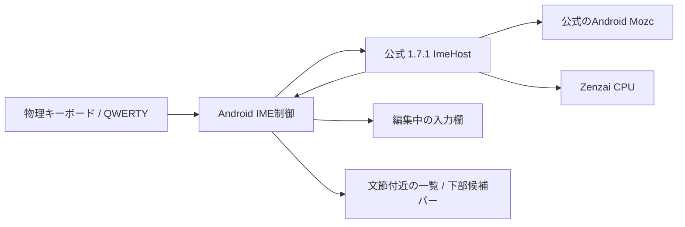

# 公式CoreとAndroid入力の境界

Meltype 1.7.1（`53fa7851c7fe30602b20be3b33c3078b2cd71111`）のC#共有CoreをNativeAOTで組み込み、Androidから公式の `ImeHost` にバージョン1のJSONイベントを送ります。公式Coreが日英判定、未確定状態、文節、予測・候補、確定、辞書・学習を保持します。Java側の変換実装はbuild 7で置き換えました。[公式タグ](https://github.com/yksr-melt/Meltype/tree/v1.7.1)・[出典と固定ハッシュ](../vendor/meltype-official/SOURCE.json)

- `OfficialImeController` はAndroidのキーと入力欄情報をイベントにし、`OfficialCoreHost` が応答を読みます。`OfficialEditor` は確定と未確定表示をアプリへ反映します。公式Coreが既確定文字の修正を指示した場合は、対象文字列をAndroid側でも照合します。
- 1打鍵で前の候補の確定と次の未確定入力が続くときは、両方の編集位置を追跡します。現在の未確定位置と食い違う古い選択通知は、入力欄の現在位置と照合して判別します。
- `HardwareCandidatePopup` は物理キーで明示変換中の候補を、編集中の文節の文字座標か挿入位置に合わせて表示します。Androidの `CursorAnchorInfo` を変換して画面内に収めます。カーソル座標を取得できないときは下部候補バーが候補を表示します。画面キーからの変換は下部候補バーを使います。
- 上下フリックはキーの行・位置を記号1・2と共有します。フリック中はIMEパネル上でキーの中心に合わせて吹き出しを描き、離したときに表示した記号を直接入力します。
- Spaceのドラッグはエディターに矢印操作を渡し、Backspaceの左ドラッグは通常の削除処理を繰り返します。ポインターの解放やキャンセル、入力欄の切り替えで繰り返しを解除します。
- 物理キーで文字を入力すると、設定に応じてQWERTY部分を畳みます。下部バーの表示切り替えで再表示できます。SpaceとBackspaceのドラッグも個別に設定できます。
- 既存のAndroid設定は `OfficialCoreConfig` が公式の `config.json` に対応づけます。「句読点入力で確定する」はAndroid側から公式Coreに確定を要求します。CPUスレッド数はZenzaiの次の実行時に反映されます。

## ネイティブ接続

公式のC#ソースに、Androidの変換結果通知、ZenzaiのCPU実行、Androidの日本語モードで英字に続く記号の判定を追加しています。記号の判定は `CompositionDetector.cs` と `CompositionText.cs` で行います。プロンプト構築、候補の妥当性判定、MozcとZenzaiの優先順位、文節編集は公式Coreで行います。

Mozcは1.7.1が固定したコミットのAndroidライブラリと辞書です。公式AndroidプレビューAPKは採用時に署名を照合し、取得時に固定SHA-256を照合します。Android側のMozcアダプターも公式タグのソースを使います。

## 入力データ

通常の入力欄ではカーソル周辺のテキストを端末内のCoreに渡します。パスワードやURL、数値入力欄では直接入力し、プライベート入力欄から前後の文脈を読みません。学習、辞書、設定はアプリ専用の非バックアップ領域に保存します。APKはINTERNET権限を持ちません。
